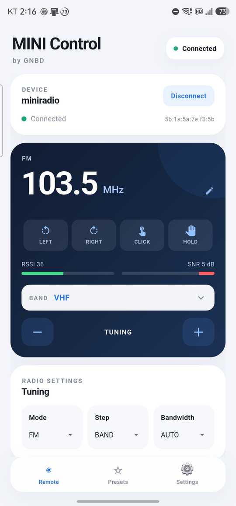
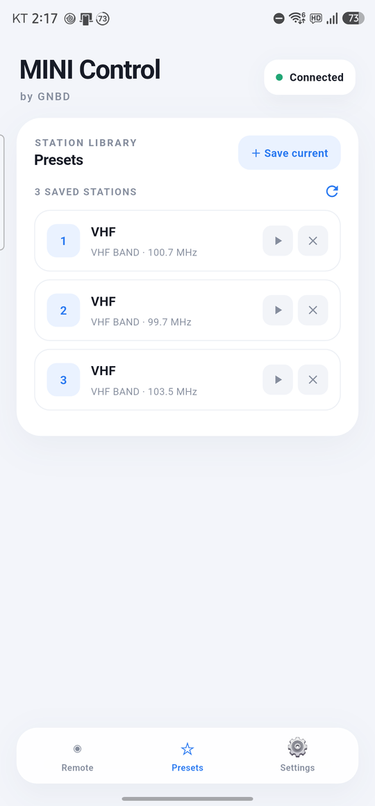
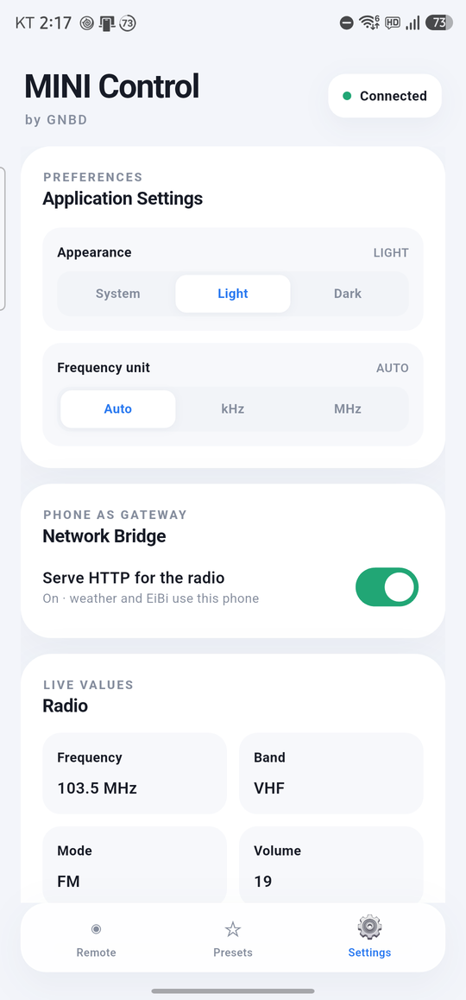
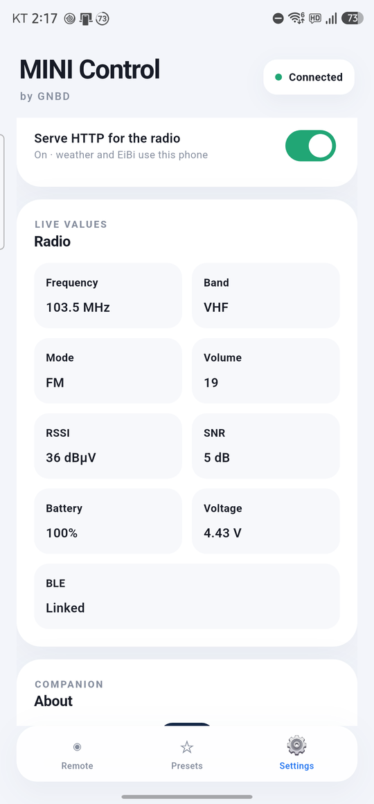

# MINI Control

⚠️This app is currently in the testing phase. The developer assumes no responsibility for any security issues, data loss, malfunctions, or other damages that may occur during use.


Android companion app for the GNBD ATS Mini / miniradio receiver.

Controls the radio over Bluetooth LE using the Nordic UART Service (NUS) and can
act as a network bridge: when the radio has no Wi-Fi, the phone fetches
weather / EiBi schedule / time and forwards the result over BLE.

## Screenshots

| Remote | Presets | Settings |
|---|---|---|
|  |  |  |

| Live values (battery / voltage) |
|---|
|  |

## Features

- BLE remote: tune, band, mode, volume, presets, radio settings
- Live status: frequency, band, mode, volume, RSSI, SNR, battery, voltage, RDS/EiBi text
- Presets: loaded from and saved to the radio
- Radio tab: step / bandwidth / AGC / squelch / FM options
- Network bridge: weather, EiBi download and clock sync without radio Wi-Fi
- Automatic reconnect to the last used radio
- Two firmware protocols, auto-detected:
  - **GNBD miniradio** (1-char commands + binary settings)
  - **Official ATS Mini** (`esp32-si4732/ats-mini`, ad hoc key protocol + monitor CSV): status, tune, volume, mode, band, memory presets, step/BW/AGC/backlight

## Requirements

- Flutter 3.47+ / Dart 3.13+
- Android SDK 36, JDK 17 or 21 (JDK 26 currently breaks AGP jlink transforms)

## Build

```bash
flutter pub get
flutter build apk --release --split-per-abi      # per-ABI APKs
flutter build apk --release \
  --target-platform android-arm,android-arm64    # universal ARM APK
```

Prebuilt APKs are in `release/`:
`miniradio-0.1.0-beta-arm64.apk`, `-armv7.apk`, `-arm-universal.apk`.

Windows x64 release: `MINI-Control-0.1.0-beta-windows-x64.zip`
(extract and run `miniradio_companion.exe`).

## Downloads

GitHub release `v0.1.0-beta` ships:

- `miniradio-0.1.0-beta-arm-universal.apk` — universal ARM APK
- `miniradio-0.1.0-beta-arm64.apk` / `-armv7.apk` — per-ABI APKs
- `MINI-Control-0.1.0-beta-windows-x64.zip` — Windows x64 build

Release signing uses `android/key.properties` (not committed). Copy
`android/key.properties.example` and point it at your own keystore.

The Windows target is kept for development; build with
`flutter build windows --debug`.

## Protocol (BLE NUS)

- Service `6E400001-B5A3-F393-E0A9-E50E24DCCA9E`
- RX `6E400002-...` (central writes)
- TX `6E400003-...` (notify)

See `lib/ble/protocol.dart` for commands and `docs/protocol.csv` for the full
command/telemetry reference (GNBD, bridge, ATS Mini).

## License

MIT. See `LICENSE` and `THIRD_PARTY_NOTICES.md`.

The firmware is a separate project (MIT, with ESP-IDF/NimBLE under Apache-2.0).
